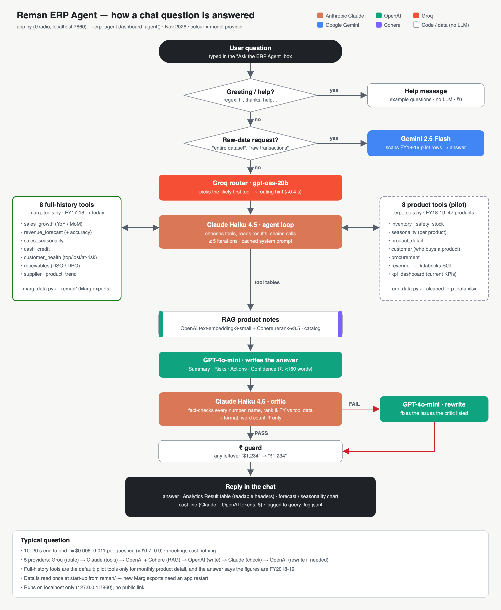

# ERP AI Agent

An AI analyst for a pharma distribution business. Ask it a question in plain English, such as "which products will stock out next quarter?", "who owes us the most?" or "what will revenue be this year?", and it runs the right ERP analysis and writes a short report: summary, risks, actions and confidence.

I built it for my own company, Reman Lifecare, which runs on Marg ERP. Small distributors sit on years of sales, stock and ledger data and never look at it, because a data analyst costs more than the problem seems worth. This agent does that job.



## How it works

Five models, each doing the one job it is cheapest and best at:

| Step | Model | Job |
|---|---|---|
| Route | Groq (`gpt-oss-20b`) | Classify the question to the most likely tool, in under a second |
| Reason | Claude Haiku 4.5 | Agent loop: pick tools, read results, call more tools, up to 5 iterations |
| Write | OpenAI `gpt-4o-mini` | Turn tool output into the Summary / Risks / Actions / Confidence report |
| Check | Claude Haiku 4.5 (critic) | Check the report's facts and format against the tool data; failed answers get rewritten |
| Retrieve | OpenAI embeddings + Cohere Rerank | Product catalogue search (RAG) for questions about salts, indications, specialties |
| Bulk | Gemini 2.5 Flash | Whole-dataset questions that no single tool answers |

Only Anthropic and OpenAI keys are required. The rest switch on when their key is present.

## The 16 tools

**Product level** (`erp_tools.py`, one year of product ledgers): inventory and months of stock left, revenue ranking, seasonality and 3-month forecast, product detail, KPI dashboard, safety stock and reorder points (95% service level, 3-month lead time), procurement vs sales, customer ranking per product.

**Business level** (`marg_tools.py`, full history of Marg exports): revenue growth by financial year, revenue forecast with backtested error, monthly seasonality index, cash vs credit sales, customer health and churn, receivables and payables with DSO/DPO, supplier concentration, product trends and dead stock.

The forecast is a trailing 12-month average. It beat Holt-Winters, SARIMA and seasonal-naive in a rolling backtest on the real data, so the simple model stays.

## Keeping it honest

- **Eval harness** (`eval_harness.py`): 40 golden questions. Each one checks that the agent called the right tool, that the answer contains the right number or name, and that the report has all four sections.
- **Critic loop:** every answer is checked against the tool data before the user sees it.
- **Drift check** (`drift_check.py`): watches recent queries for four signals: critic failure rate, cost spikes, slow responses and tool misses.
- **Query log:** every question records the tools used, cost, latency and critic result.
- **Daily alert** (`daily_alert.py`): stockout and reorder alerts by email and WhatsApp every morning.

## Data

The real company data stays private. This repo ships a **synthetic dataset** in `sample_data/` with the same file layouts as the Marg ERP exports, so every loader and tool runs unchanged. Customer names, suppliers, quantities and amounts are made up. Product names come from the public product catalogue in `knowledge_base/`.

```bash
python sample_data/make_sample_data.py   # regenerate it (fixed seed)
```

Point it at real exports with `ERP_DATA_FILE` and `MARG_DATA_DIR`, or drop `cleaned_erp_data.xlsx` and a `reman/` folder next to `app.py`. The eval's expected answers match the synthetic data, so they need updating for real data.

## Run it

```bash
pip install -r requirements.txt
cp .env.example .env        # add ANTHROPIC_API_KEY and OPENAI_API_KEY at minimum
python app.py               # Gradio app on http://localhost:7860
python eval_harness.py      # golden-question eval (makes real API calls)
```

## Product work

`BMAD/` holds the product side: brief, PRD, a one-page PRD, Lean Canvas, architecture, alignment notes and sprint stories. The next phase is a payments and collections module: a ledger per customer, a 90-day overdue rule and a credit block.

## Layout

```
app.py              Gradio UI
erp_agent.py        router, agent loop, summariser, critic, RAG
erp_tools.py        product-level tools (+ optional Databricks query)
marg_tools.py       business-level tools
erp_data.py         product ledger loader, ABC classes, safety stock, KPI cache
marg_data.py        Marg export loaders, monthly revenue, forecast backtest
erp_charts.py, marg_charts.py   Plotly charts
eval_harness.py     golden-question eval
drift_check.py, daily_alert.py, session_store.py
sample_data/        synthetic dataset + generator
knowledge_base/     public product catalogue and its embeddings
BMAD/               product documents
```
